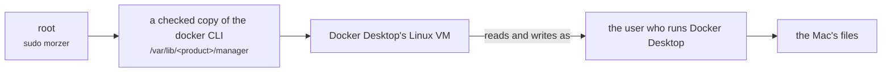

# Platforms

morzer runs installations on Linux, and on a Mac with Apple silicon and Docker
Desktop, for a release whose vendor made it for one. A Mac is a weaker host
than a Linux server, and this page names each way it is weaker: who can read
what, where secrets sit, what runs without you, and what has been checked.
`doctor` reports each of them on the machine.

!!! warning "No manager release has passed the acceptance run on a Mac yet"

    A manager release ships a macOS archive only when its acceptance run has
    passed on a Mac with Docker Desktop, and none has yet. Until one does,
    `install.sh` on a Mac says the release publishes no `darwin/arm64`
    archive. The first release that ships one names here the macOS and Docker
    Desktop releases it was verified on.

## The shape of it

The manager runs as root, as on Linux. The containers do not run on the Mac:
they run in Docker Desktop's Linux VM, and they reach the Mac's files as the
user who runs Docker Desktop, whatever uid a container runs as. Most of what
follows comes from that one fact.

## Root, and the user who runs Docker Desktop

That user is whoever owns the socket `/var/run/docker.sock` names. The manager
reads it at every render and every `apply`, so a different user starting
Docker Desktop later is followed. It refuses while the link is missing, which
is what Docker Desktop looks like before its "default Docker socket" setting
is allowed, and while the socket is root's.

That user owns Docker Desktop's own `docker` CLI and Compose plugin, so root
never runs them. Before root runs either, the manager copies them into a
directory under `/var/lib/<product>/manager` that only root can write, and
checks that each copy is signed by Docker. It runs only the copies, and copies
them again when Docker Desktop's version changes. Without Docker Desktop's
app, root runs the `docker` CLI on `PATH` only while root alone can replace it
and the Compose plugin it loads. `doctor` says which CLI root runs, under
`runtime.cli`.

A hook gets that CLI's directory first on `PATH`, and the manager's docker
configuration. A hook is refused, exit 3, while anyone but root could replace
an entry in a directory that CLI searches for plugins, since a command that
lists them, `docker info` say, runs each one as root.

## The paths

The paths are Linux's, except one:

| Directory | Linux | Mac |
| --- | --- | --- |
| Configuration | `/etc/<product>` | `/etc/<product>`, which is `/private/etc/<product>` |
| State and data | `/var/lib/<product>` | `/var/lib/<product>`, which is `/private/var/lib/<product>` |
| Releases | `/opt/<product>` | `/opt/<product>` |
| Rendered secrets | `/run/<product>` | `/var/run/<product>`, since a Mac has no `/run` |

A release that renders a file to a `render_to` under `/run/` gets it under
`/var/run/` on a Mac. Compose receives the path the release wrote, and the
variables it gets say where the files went.

Docker Desktop shares `/Users`, `/Volumes`, `/private`, `/tmp` and
`/var/folders` with containers by default, and not `/opt`. Add `/opt` to its
file sharing. `doctor` checks that a container can list each managed directory
and write the data directory, under `runtime.file-sharing`.

## Who can read what

Root keeps every directory it trusts, at `0755`, so other accounts on the Mac
can list them. That user has to be able to list each directory on the way to a
file a container reads, and no group holds that user alone.

- **A rendered configuration file is readable by other accounts.** It stays
  root's, at the release's mode with read for others added, so `0640` becomes
  `0644`. `apply` puts back a read bit taken away.
- **Rendered secrets are readable by root and that user alone.** Each is that
  user's, `0400` in a `0700` directory.
- **A secret's `owner` is not enforced.** A container reads a secret only when
  that user can, and then every container that mounts it can, whatever uid it
  runs as. `doctor` warns `secrets.owner` while a release declares one.
- **The data directory a container writes is that user's.** The age identity,
  the signing key, the state, the backups and the releases stay root's, at
  their Linux modes.

## Secrets on a disk

A Mac has no memory-backed filesystem, so rendered secrets are written to disk,
and `doctor` warns `secrets.ephemeral-storage` every time. The age identity is
on the same disk, so FileVault has to be on:

- `init` refuses with FileVault off before it writes anything, exit 6.
- Every render and every `secret` change refuses with it off, exit 6.
- `doctor` fails `secrets.disk-encryption` while it is off.

`init --allow-unencrypted-disk` goes on regardless, and records
[`secrets.allow_unencrypted_disk`](../reference/parameters.md#installation-settings-are-not-parameters),
which is journalled. `doctor` still fails while FileVault is off.

## Nothing routes the Mac

A container's host network and `/dev/net/tun` are the VM's, not the Mac's. A
VPN or TUN profile on a Mac would route the VM and look like success, so a
release marks such a profile Linux-only, and it is refused on a Mac. No
installation routes a Mac's own traffic.

## Nothing runs without you

On a Mac there is no supervisor yet: nothing converges at boot, and no
schedule runs. `backup.schedule`, `doctor.schedule`, `update.schedule` and
`sync.interval` are recorded and do nothing there. `doctor` warns of it
under `system.units`, naming each one the installation sets.

A restart clears `/var/run`, and the rendered secrets with it. Docker Desktop
starts when its user logs in, and restarts the containers that have a restart
policy. Run `sudo morzer apply` after every restart, once Docker Desktop is
running: it renders the secrets again and brings the installation back to what
its release declares. Run what is scheduled by hand when it is due, `sudo
morzer backup` say.

## Verified, and where

- **Every change to the code** runs the unit tests on a hosted macOS runner.
  That runner has no Docker engine.
- **Every release** that ships a macOS archive has passed the acceptance run by
  hand on an Apple-silicon Mac with Docker Desktop, against a real engine. Its
  record, with the macOS and Docker Desktop versions, is committed in the
  release's pull request. A release without that record ships no macOS
  archive.
- **On the machine**, `doctor` warns `runtime.engine-version` when Docker
  Desktop is a release the acceptance run did not pass on.

Intel Macs are not supported: the macOS build is `darwin/arm64` only, and
`install.sh` refuses on one. A shell under Rosetta on Apple silicon gets the
`arm64` build.

A vendor who wants a release to run on a Mac has a few things to change in the
bundle first; [running a release on a Mac](../authoring/running-on-a-mac.md)
lists them. Installing on one is in
[Installing morzer](../get-started/installation.md#on-a-mac).
